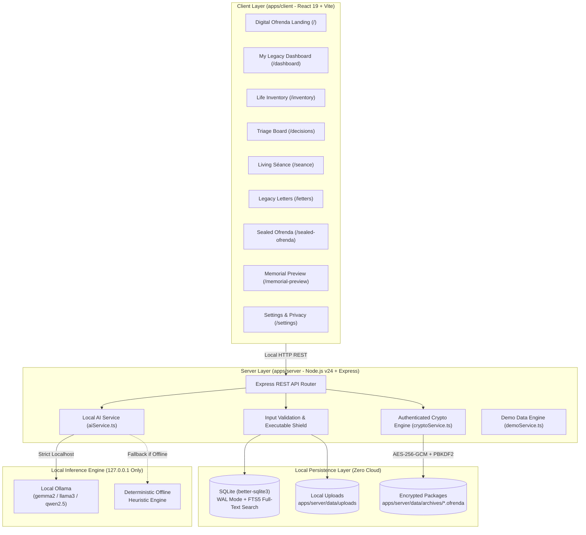
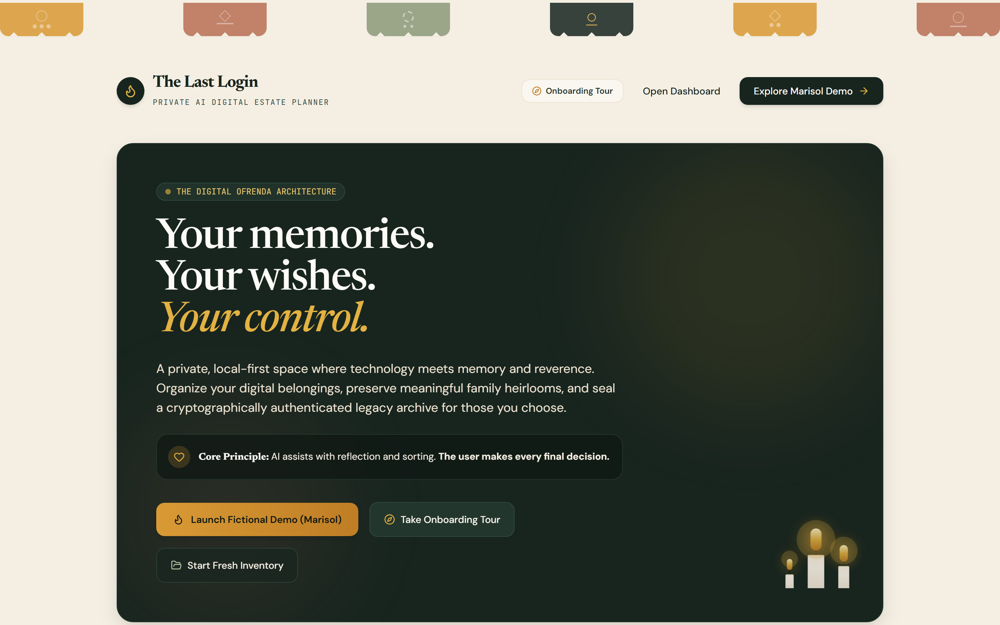
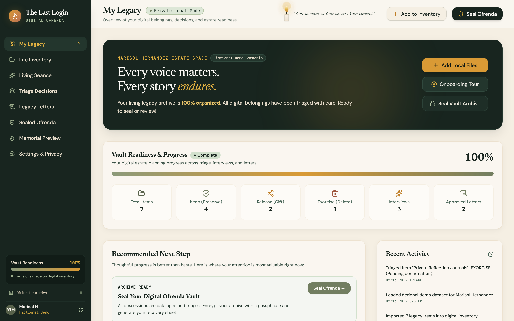
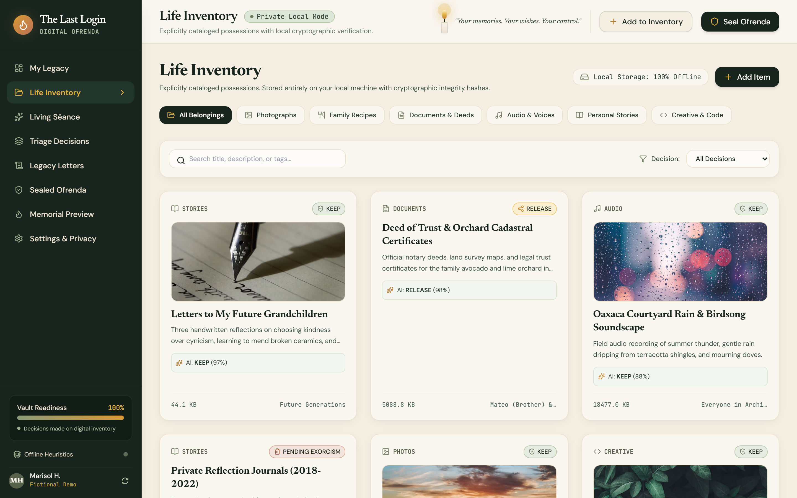
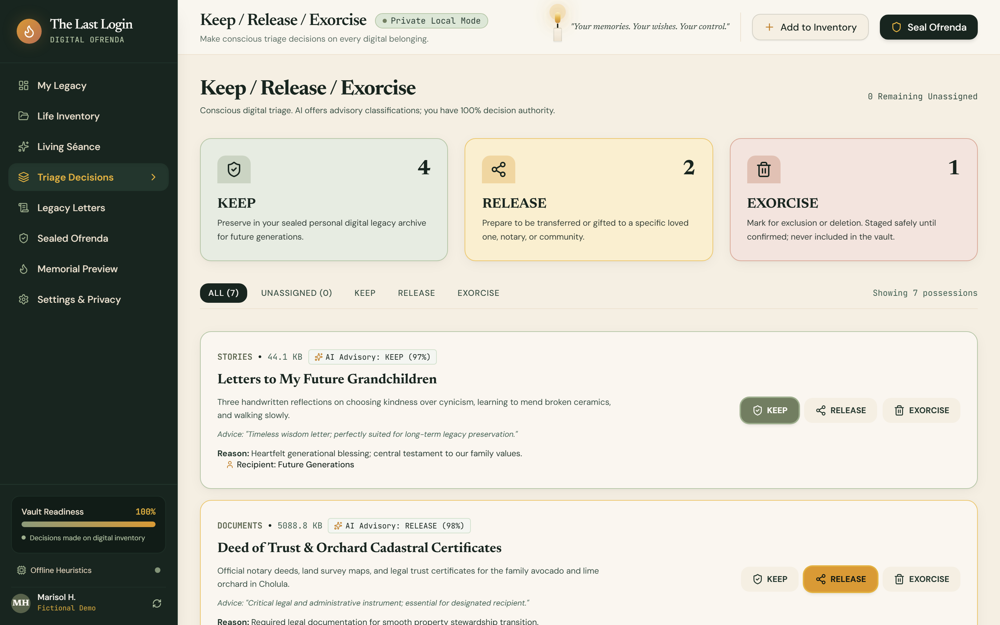
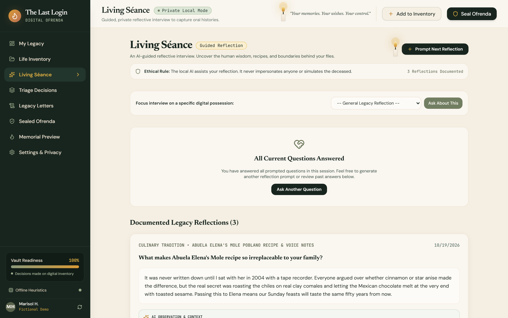
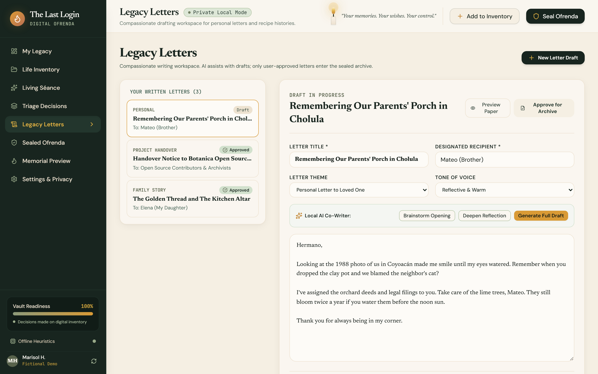
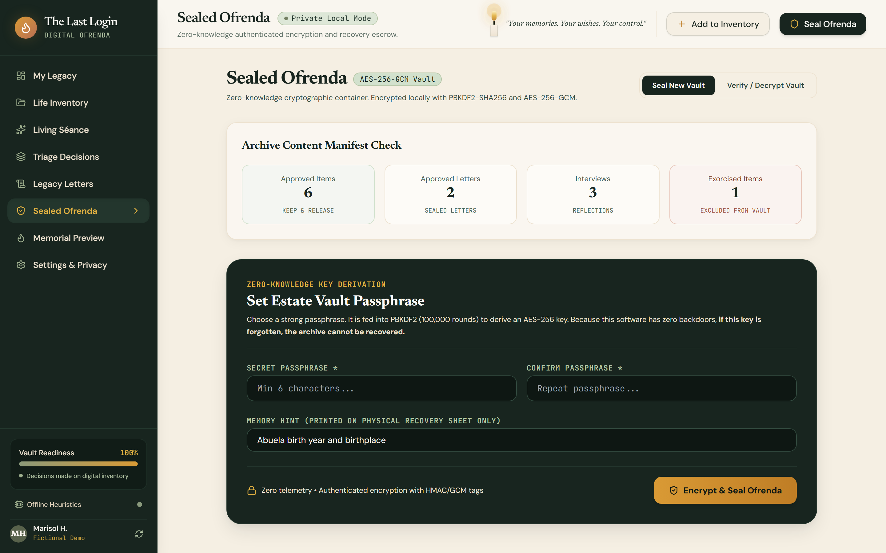
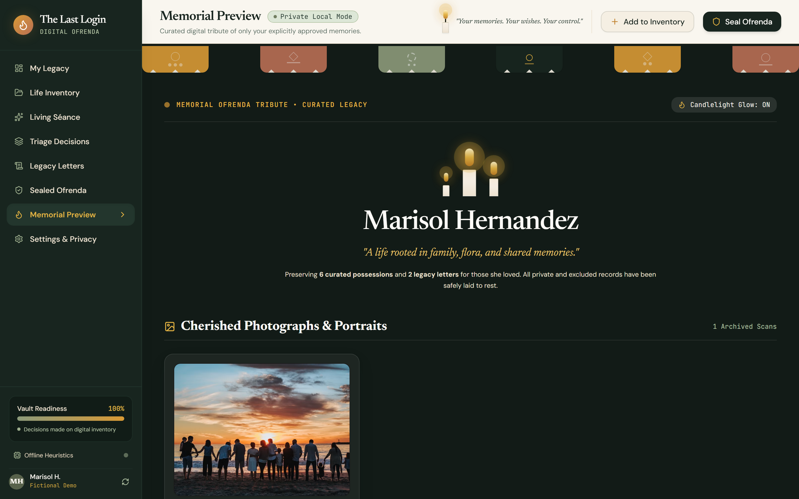
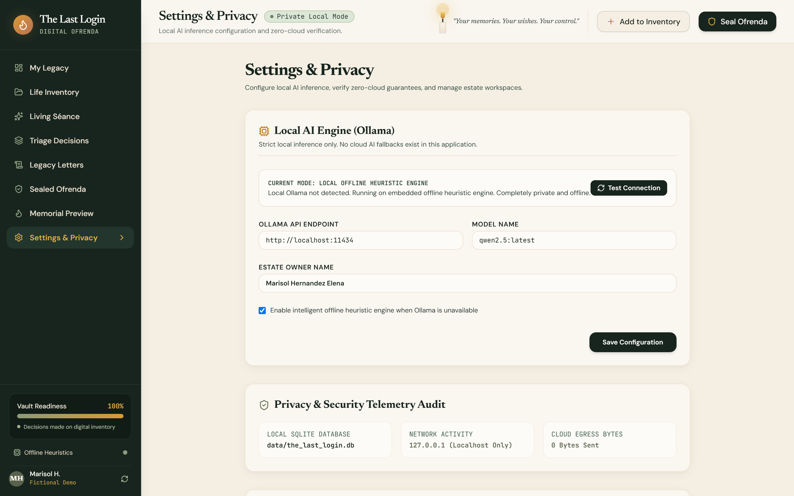

# The Last Login 🕯️

> **Tagline:** Your memories. Your wishes. Your control.  
> **Concept:** A Private AI Digital Estate Planner.

[](https://the-last-login-green.vercel.app)
[](https://github.com/rudrarajsinh920/The-Last-Login)
[](https://github.com/rudrarajsinh920/The-Last-Login)
[](LICENSE)
[](docs/ARCHITECTURE.md)
[](docs/CRYPTOGRAPHY_AND_KEY_RECOVERY.md)

**The Last Login** is a private, production-grade, open-source application designed to help living individuals organize their digital belongings, document their wishes, preserve meaningful family memories, and prepare an authenticated, encrypted digital legacy archive for the people they choose.

It does not treat digital estate planning as a cold, transactional checklist or a synthetic "digital resurrection" chatbot. Instead, it grounds the experience in **The Digital Ofrenda** — a warm, calm, reflective space where technology meets memory, privacy, and human reverence.

**Core Principle:** **AI assists. The user decides.**

---

## Table of Contents

1. [Visual Identity & Design Philosophy](#visual-identity--design-philosophy)
2. [System Architecture](#system-architecture)
3. [Visual Route Tour & Screenshots](#visual-route-tour--screenshots)
4. [Core Features & User Journeys](#core-features--user-journeys)
5. [Local AI & Offline Intelligence](#local-ai--offline-intelligence)
6. [Cryptography & Sealed Ofrenda Format](#cryptography--sealed-ofrenda-format)
7. [Emergency Key Recovery & Escrow](#emergency-key-recovery--escrow)
8. [Fictional Demo Walkthrough (Marisol Hernandez)](#fictional-demo-walkthrough-marisol-hernandez)
9. [Installation & Quick Start](#installation--quick-start)
10. [Automated Verification & Test Suite](#automated-verification--test-suite)
11. [Privacy Architecture & Security Posture](#privacy-architecture--security-posture)
12. [Known Limitations](#known-limitations)

---

## Visual Identity & Design Philosophy

The visual identity is inspired by the warmth, reverence, and sensory atmosphere of Día de los Muertos ofrendas — celebrating life, memory, and agency without morbidity:

- **Midnight Olive (`#18251F`):** Grounding, solemn, and editorial navigation surfaces.
- **Warm Parchment (`#F5EFE3`):** Tactile paper reading surfaces for letters and reflections.
- **Marigold (`#D99A35`):** Golden cempasúchil amber for primary call-to-actions, guidance, and candle glow.
- **Terracotta (`#B96F54`):** Warm clay tones for boundary management, triage actions, and exorcisms.
- **Sage (`#8C9A7A`):** Soft heritage green for archival preservation and progress bars.
- **Typography:** **Newsreader** (editorial serif headings), **DM Sans** (clean interface labels & body), and **JetBrains Mono** (cryptographic hashes, checksums, and timestamps).

```
   ┌─────────────────────────────────────────────────────────────┐
   │                                                             │
   │   [#18251F] Midnight Olive   •   Navigation & Structure     │
   │   [#F5EFE3] Warm Parchment   •   Surfaces & Letters         │
   │   [#D99A35] Marigold Amber   •   Candlelight & Action       │
   │   [#B96F54] Terracotta Clay  •   Triage & Boundaries        │
   │   [#8C9A7A] Sage Foliage     •   Integrity & Preservation   │
   │                                                             │
   └─────────────────────────────────────────────────────────────┘
```

---

## System Architecture

The application is structured as a TypeScript monorepo with strict domain separation, local-only data persistence, and zero telemetry.

### Architectural Diagram



### Data Flow & Component Overview

1. **Client Workspace (`apps/client`)**: React 19 single-page application with Tailwind CSS, Lucide icons, responsive navigation (sidebar desktop + drawer mobile), and interactive candle glow effects.
2. **Server Workspace (`apps/server`)**: Node.js v24 Express service running on `localhost:3001` with strict CORS isolation and zero external network calls.
3. **Database (`better-sqlite3`)**: Runs locally in Write-Ahead Logging (`WAL`) mode with SQLite FTS5 for instant client-side full-text search across files and letters.
4. **Shared Contracts (`packages/shared`)**: Shared TypeScript types and Zod schemas guaranteeing runtime type safety between client and server.

---

## Visual Route Tour & Screenshots

Every major route in The Last Login has been captured live from the running application:

### 1. Digital Ofrenda Welcome & Onboarding (`/`)
*Atmospheric landing page introducing the philosophy of digital legacy, memory preservation, and an interactive 4-step Onboarding Tour.*



---

### 2. My Legacy Dashboard (`/dashboard`)
*Comprehensive estate overview featuring the Vault Readiness meter, KEEP/RELEASE/EXORCISE counters, recommended next steps, and live activity audit log.*



---

### 3. Life Inventory (`/inventory`)
*Catalog of user possessions with category filters, SHA-256 checksums, local file indicators, and full-text search.*



---

### 4. Keep / Release / Exorcise Triage Board (`/decisions`)
*Tactile 3-folder decision matrix with AI advisory recommendations, recipient assignment, and safe staged deletion requiring explicit secondary confirmation.*



---

### 5. Living Séance Guided Reflection (`/seance`)
*Private, thoughtful interview room inspired by editorial memoirs. Uncovers oral histories and family lore one question at a time.*



---

### 6. Legacy Letters Studio (`/letters`)
*Editorial drafting studio for personal letters, recipe secrets, and open-source project handovers with AI tone polish and approval controls.*



---

### 7. Sealed Ofrenda Cryptographic Vault (`/sealed-ofrenda`)
*Authenticated AES-256-GCM archive creation, PBKDF2 key derivation, container export (`.ofrenda`), in-app integrity decryption, and printable emergency key recovery sheets.*



---

### 8. Memorial Preview (`/memorial-preview`)
*Curated tribute space honoring memories with interactive candlelight. Strictly filters out all exorcised files, private keys, and temporary drafts.*



---

### 9. Settings & Privacy Audit (`/settings`)
*Local Ollama model selector (`gemma2`, `llama3`, `qwen2.5`), zero-cloud egress telemetry audit (0 bytes sent), and 1-click fictional demo loader.*



---

## Core Features & User Journeys

| # | Feature Area | User Action & Capabilities | Security / Architectural Guarantee |
|---|---|---|---|
| **1** | **Onboarding Tour** | Complete 4-step interactive guide on digital estate principles and key recovery. | Zero remote accounts required. Everything stays on `localhost`. |
| **2** | **Fictional Demo** | 1-click loading of the Marisol Hernandez estate dataset. | Realistic test data across all 6 categories without touching personal files. |
| **3** | **Life Inventory** | Select local files, assign categories, and generate SHA-256 hashes. | Executable files (`.exe`, `.bat`, `.sh`, `.cmd`, `.ps1`) are blocked immediately. |
| **4** | **Integrity Checksums** | View cryptographic SHA-256 checksums and file size metadata. | Prevents silent file tampering or corruption. |
| **5** | **Local AI Triage** | Request advisory KEEP/RELEASE/EXORCISE triage suggestions with rationale. | AI decisions are advisory only. User makes the final decision. |
| **6** | **Living Séance** | Answer thoughtful memory prompts, save reflections, edit answers, or skip. | Never attempts to impersonate deceased loved ones. Strictly reflective. |
| **7** | **Triage Decisions** | Move items between KEEP, RELEASE, and EXORCISE folders; assign recipients. | EXORCISE moves files to a pending queue; requires secondary modal confirmation. |
| **8** | **Destruction Protection** | Confirm permanent file deletion with explicit user modal warning. | No silent or automated background file deletion. Ever. |
| **9** | **Legacy Letters** | Draft, refine with local AI assistance, and mark letters as APPROVED. | Unapproved draft letters are not sealed into the final memorial package. |
| **10**| **Sealed Ofrenda Export**| Encrypt chosen legacy assets into a standalone `.ofrenda` archive file. | AES-256-GCM with 100,000 PBKDF2-SHA256 iterations and random salt/IV. |
| **11**| **Integrity Verification**| Import `.ofrenda` package, decrypt with passphrase, and verify checksums. | GCM 16-byte authentication tag validates file integrity and flags corruption. |
| **12**| **Memorial Preview** | Review the public remembrance space before sealing the archive. | Exorcised items and unapproved drafts are strictly excluded from the view. |
| **13**| **Settings & Privacy** | Configure Ollama endpoint, choose models, or enable offline heuristics. | Verifiable telemetry audit confirms 0 bytes transmitted outside `127.0.0.1`. |

---

## Local AI & Offline Intelligence

The Last Login enforces a strict local-first AI boundary:

### 1. Supported Local Ollama Models

The application communicates directly with local Ollama instances over `http://localhost:11434`:

- **Gemma 2 (`gemma2:latest` - Recommended):** Excellent balance of emotional sensitivity, reasoning, and performance for estate letters and memory questions.
- **Llama 3 (`llama3:latest`):** Robust for detailed technical handover documentation and code repository curation.
- **Qwen 2.5 (`qwen2.5:latest`):** High precision for multilingual legacy letters and inventory categorization.

#### Setting up Ollama locally:
```bash
# 1. Install Ollama from https://ollama.com
# 2. Pull the recommended model
ollama pull gemma2:latest

# 3. Start the Ollama background service
ollama serve
```

### 2. Embedded Offline Heuristic Engine

When Ollama is not installed or when running on machines without dedicated GPU acceleration, The Last Login automatically engages its **Deterministic Offline Heuristic Engine**:

- Requires **0 downloads** and **0 cloud network requests**.
- Analyzes file extensions, MIME types, and content tokens to provide contextual KEEP/RELEASE/EXORCISE recommendations.
- Offers culturally respectful prompts for culinary heritage, life stories, and digital account handovers.
- Operates entirely within the Node.js process with sub-millisecond execution times.

---

## Cryptography & Sealed Ofrenda Format

The `.ofrenda` container file uses authenticated symmetric encryption to guarantee confidentiality, authenticity, and tamper detection:

```
+-------------------------------------------------------------------------+
|                    Sealed Ofrenda Container (.ofrenda)                  |
+-------------------------------------------------------------------------+
|  Header Metadata:                                                       |
|    - version: "1.0.0"                                                   |
|    - archiveId: "ofrenda_1793344264824_9a45d673"                       |
|    - ownerName: "Marisol Hernandez"                                     |
|    - salt: 32 cryptographically random bytes (hex)                      |
|    - iv: 12 cryptographically random bytes (hex)                        |
|    - authTag: 16-byte GCM authentication tag (hex)                      |
|    - iterations: 100000 (PBKDF2-HMAC-SHA256)                            |
+-------------------------------------------------------------------------+
|  Ciphertext (Base64 Encrypted Payload):                                 |
|    - Encrypted Inventory (Only KEEP and RELEASE items)                  |
|    - Encrypted Approved Legacy Letters                                  |
|    - Encrypted Living Séance Interview Transcripts                      |
|    - Asset SHA-256 Checksums Manifest                                   |
|    * STRICT EXCLUSION: All items marked EXORCISE are omitted            |
+-------------------------------------------------------------------------+
```

### Technical Cryptographic Parameters

- **Cipher:** `AES-256-GCM` (authenticated symmetric encryption).
- **Key Derivation Function (KDF):** `PBKDF2` with `HMAC-SHA256`.
- **Derivation Iterations:** `100,000` rounds by default (bounded safely between `10,000` and `2,000,000` during import to prevent DoS attacks).
- **Salt:** 32 cryptographically random bytes (`crypto.randomBytes(32)`).
- **Initialization Vector:** 12 cryptographically random bytes (`crypto.randomBytes(12)`).
- **Authentication Tag:** 16 bytes (128 bits) verifying payload integrity. Any modification to ciphertext or parameters immediately invalidates decryption.
- **Per-Asset Checksums:** Independent `SHA-256` hash recorded for every included memory.

---

## Emergency Key Recovery & Escrow

> [!WARNING]
> **Zero-Knowledge Architecture:**  
> The Last Login does not store user passphrases on remote servers, in cookies, or in unencrypted database fields. There is no password reset link or back-door recovery mechanism. **If the user loses their passphrase, the `.ofrenda` archive cannot be decrypted by anyone.**

### Physical Escrow Workflow

To solve the key recovery challenge without compromising privacy:

1. **Print Emergency Key Recovery Sheet:** In the **Sealed Ofrenda** screen, click **"Print Key Recovery Sheet"**.
2. **Handwrite the Passphrase:** Write the master passphrase by hand on the physical printed sheet. Never store the plaintext passphrase on an unencrypted USB drive or desktop file.
3. **Dual Custody / Safe Storage:** Store the printed recovery sheet alongside physical estate documents (e.g., in a fireproof home safe, bank safe deposit box, or with an estate attorney).
4. **Executor Instructions:** The sheet includes step-by-step instructions for the executor or designated recipient explaining how to install The Last Login and decrypt the archive.

---

## Fictional Demo Walkthrough (Marisol Hernandez)

The repository includes a complete, pre-configured fictional estate scenario for **Marisol Hernandez** (age 68, retired architect and family archivist):

1. **Launch the Demo:** Click **"Explore Fictional Demo"** on the landing page or click **"Load Marisol Hernandez Demo"** in Settings.
2. **Review the Dashboard:** Notice the **71% readiness progress** meter, 4 items marked KEEP, 2 items marked RELEASE, and 1 item marked EXORCISE.
3. **Inspect Life Inventory:**
   - *Abuelita's Mole Negro Recipe Notes* (Family Recipes — KEEP)
   - *Letters to My Future Grandchildren* (Personal Stories — KEEP)
   - *Primary Cloud Password Manager Backup* (Credentials — RELEASE to executor)
   - *Draft Personal Grief Journals 2018-2020* (Personal — EXORCISE)
   - *Architecture Studio GitHub Repository Key* (Code & Projects — RELEASE)
4. **Experience Living Séance:** Review Marisol's reflections on the cedar chest aroma and the origins of Sunday family dinners. Edit an answer or ask the local AI for a thoughtful follow-up prompt.
5. **Triage & Deletion Safeguard:** Switch to `/decisions`. Attempt to delete an exorcised item. Observe the **explicit confirmation modal** warning that this action permanently excludes the item from the legacy archive.
6. **Polish Legacy Letters:** Open `/letters` to view Marisol's letter to her grandchildren explaining the secret clove measurement in the mole recipe.
7. **Seal the Archive:** Go to `/sealed-ofrenda`, enter a passphrase (e.g. `cempasuchil2026`), and click **"Seal & Export Ofrenda"**. Download the resulting `.ofrenda` file.
8. **Verify Memorial View:** Open `/memorial-preview` to inspect the tribute altar. Confirm that Marisol's recipes, letters, and family photos appear under the warm candle glow, while the private grief journals and password backups are completely absent.

---

## Installation & Quick Start

### Prerequisites

- **Node.js** v20.x or v24.x
- **NPM** v10+
- Modern web browser (Chrome, Edge, Firefox, Safari)
- *Optional:* Local [Ollama](https://ollama.com) installation for open-weight LLM inference

### 1. Clone & Install

```bash
# Clone the repository
git clone https://github.com/rudrarajsinh920/The-Last-Login.git
cd The-Last-Login

# Install monorepo dependencies
npm install

# Build shared contracts
npm run build:shared
```

### 2. Environment Configuration

Copy the example environment file (no secrets required):

```bash
cp .env.example .env
```

`.env.example` contents:
```env
PORT=3001
NODE_ENV=development
OLLAMA_ENDPOINT=http://localhost:11434
OLLAMA_MODEL=gemma2:latest
VITE_API_URL=http://localhost:3001
```

### 3. Launch Development Servers

```bash
# Runs Express Server (port 3001) and Vite Client (port 5173) concurrently
npm run dev
```

Open your browser to:
```
http://localhost:5173
```

### 4. Build for Production

```bash
npm run build
```

This compiles:
- `packages/shared` via TypeScript compiler (`tsc`)
- `apps/server` via TypeScript compiler (`tsc`)
- `apps/client` via Vite production pipeline

---

## Automated Verification & Test Suite

The repository includes comprehensive automated unit, cryptographic, and end-to-end journey tests.

### Running the Test Suite

```bash
npm run test --workspace=@the-last-login/server
```

### Verified Test Results

```
✔ Database initializes and loads Marisol demo dataset (27.44ms)
✔ Cryptographic Sealed Ofrenda: AES-256-GCM encryption & integrity verification (404.50ms)
✔ Journey 1: Health check, system initialization & privacy policy (5.64ms)
✔ Journey 2: Open and seed the fictional Marisol demo dataset (17.95ms)
✔ Journey 3 & 4: Import local file, compute SHA-256 checksum & verify metadata (3.69ms)
✔ Journey 5: Local AI classification (Ollama / offline heuristic engine) (126.30ms)
✔ Journey 6: Complete, edit, skip, and save Living Séance reflections (7.90ms)
✔ Journey 7 & 8: Assign KEEP, RELEASE, EXORCISE and verify explicit deletion approval (2.34ms)
✔ Journey 9: Draft, assist with AI tone, and approve a Legacy Letter (10.29ms)
✔ Journey 10 & 11: Sealed Ofrenda AES-256-GCM authenticated encryption, export & integrity verification (530.73ms)
✔ Journey 12: Memorial Preview strictly excludes private and EXORCISED records (13.43ms)
✔ Journey 13: System settings update and persistence (0.85ms)

ℹ tests 12 | suites 0 | pass 12 | fail 0 | cancelled 0 | skipped 0
```

---

## Privacy Architecture & Security Posture

| Security Check | Implementation Status | Technical Mechanism |
|---|---|---|
| **Cloud AI Egress** | **0 Bytes Transmitted** | Requests route strictly to `127.0.0.1:11434`. No telemetry SDKs. |
| **Executable Shield** | **Enforced** | Rejects `.exe`, `.bat`, `.cmd`, `.sh`, `.ps1`, `.msi`, `.vbs` on upload. |
| **Path Traversal Protection** | **Enforced** | Filenames are stripped of path components; stored via UUID in isolated directories. |
| **SQL Injection Safety** | **Enforced** | 100% parameterized SQLite statements via `better-sqlite3`. Zero raw concatenation. |
| **Symmetric Encryption** | **Enforced** | `AES-256-GCM` with authenticated 16-byte tag. |
| **Key Derivation** | **Enforced** | `PBKDF2-HMAC-SHA256` with 100,000 iterations and 32-byte cryptographically secure salt. |
| **DoS Header Protection** | **Enforced** | Iteration counts on imported archives are bounded between 10,000 and 2,000,000. |
| **Accidental Data Loss** | **Enforced** | Exorcised items are quarantined in a pending stage. Permanent deletion requires explicit secondary confirmation. |
| **Exorcism Exclusion** | **Enforced** | Exorcised items and unapproved drafts are strictly stripped from archive payloads. |
| **Database & Secret Hygiene**| **Enforced** | `.gitignore` excludes `*.db`, `*.db-wal`, `uploads/*`, `*.ofrenda`, and `.env`. |

---

## Known Limitations

In the spirit of honest engineering and transparent open-source communication:

1. **No Automated "Dead Man's Switch":** The Last Login is an active estate planning tool for living people. It deliberately does not include automated death verification or external webhooks in this MVP, avoiding unreliable third-party mortality oracles.
2. **Single-Node Local Storage:** Files are stored in the host machine's local directory (`apps/server/data/uploads`). The software does not provide multi-device automatic sync; users should create periodic off-site backups of their `.ofrenda` vault files.
3. **Zero-Knowledge Passphrase Dependency:** If the user forgets their passphrase and has not printed an Emergency Key Recovery Sheet, the archive payload cannot be recovered. There is no backdoor.
4. **Browser File System Permissions:** Standard browser security requires users to explicitly select files or folders via the file picker modal; the application cannot silently inspect the host machine's background directories.
5. **Independent Audit Notice:** While The Last Login implements standard authenticated cryptographic primitives (`AES-256-GCM`, `PBKDF2-SHA256`), it has not been certified by an independent commercial auditing firm. It is provided under the MIT License for personal and community use.

---

## License

This project is licensed under the **MIT License** — see the [LICENSE](LICENSE) file for details.

*Dedicated to preserving human memory, cultural dignity, and digital sovereignty.* 🕯️
